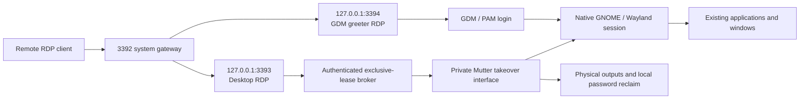

# Ubuntu Native Session Takeover

Take over the original native GNOME/Wayland desktop over RDP while keeping the current windows and application processes. Supports physical-screen privacy, authenticated local reclaim by password, and an experimental GDM login handover.

Experimental RDP takeover of the original GNOME Wayland session, with physical-seat privacy and authenticated local reclaim. This is a source release for development and review, not a supported general-purpose installer.

**Project status: experimental source release.** The most recent startup-lock and login-handover fixes have passed isolated tests; full acceptance with a real cold-boot GDM/PAM login, physical displays and every client combination has not yet been recorded. This repository does not ship the development machine's install packages, credentials, logs or build artifacts, and does not promise "clone and install" behavior.

## What it does

- Remote and local users operate the same GNOME Shell and the same set of applications; disconnecting RDP does not log the desktop out.
- Physical input is isolated after authentication. Physical outputs show a separate password-reclaim screen while remote capture keeps reading the desktop scene.
- After the local password is verified through PAM, remote capture and input are revoked first, then local access is restored.
- Remote resolution, scale and monitor layout can be changed temporarily; the saved layout is restored after disconnect. The temporary layout is never written to `monitors.xml`.
- Multiple client monitors (for example mstsc "Use all my monitors", up to four): the primary client monitor is the taken-over desktop; every other client monitor becomes a remote-only Mutter virtual monitor at the client's position. Remote-only monitors are never shown on a physical output and disappear on disconnect or local reclaim. Only virtual monitors tagged by the leased GRD qualify; other screen casts stay behind the physical barrier. Disable with `scripts/remote-settings.py --multi-monitor off` (applies when the backend next starts). The GDM greeter stays single-screen: a boot-login connection first shows the login screen on the primary client monitor, and after the redirect to the desktop every client monitor is used.
- The remote scale is independent of the local displays and follows the RDP client: the desktop scale the client announces (for example 125% from Windows) is used when it connects and whenever it changes, rounded to 100, 125, 150, 175 or 200%. During a session the scale can be changed in GNOME Settings → Displays or with `scripts/remote-settings.py --scale 100|125|150|175|200`; such a change lasts until the client announces a different scale or reconnects. The saved `--scale` value (default 150%) is only the fallback for clients that announce no scale; the GDM greeter cannot read it and falls back to 100%.
- While a remote session is active, GNOME Settings → Displays can change only the scale of the remote desktop. A request that changes anything else (resolution, refresh rate, orientation, position, or which monitors are enabled) is rejected, and the physical monitor layout is never changed or saved.
- "UST" (Ubuntu Session Takeover) in the application menu, or the `ust` command, is a small dashboard: it shows whether a remote session is active with its resolution, scale and number of monitors, changes the scale with one click, and switches the use of every client monitor. `ust --status` prints the same state as JSON and `ust --scale 125` sets the scale. An installation made before this launcher existed gets it with `python3 /opt/ubuntu-native-takeover/scripts/remote-settings.py --install-shortcut` (as the desktop user, no sudo).
- Boot-login mode forwards RDP to the actual GDM greeter, then redirects to that user's physical desktop; no second working desktop is created.
- When the startup-lock state is out of sync, confirmation is retried, and after a timeout local-authentication recovery is offered so the session does not stay on a privacy black screen forever.

Logging out, rebooting or a compositor crash still ends the applications. Disconnecting RDP and logging out are different operations.

## Architecture



3393 and 3394 are loopback backends; 3392 is the external entry point in system-login mode. The gateway forwards encrypted RDP. RDP authentication is performed by GRD/FreeRDP, and system-account authentication by GDM/PAM. Login handover establishes a new RDP handshake; it never switches an already authenticated byte stream to another backend.

See [Architecture and state machine](docs/ARCHITECTURE.md) for details.

## Supported platform

The development target is **Ubuntu 26.04 amd64, GNOME Shell/Mutter 50.1, Mutter ABI 18, GRD 50.2**, and only the exact package combinations listed in the compatibility profiles are accepted. The source patch baseline is pinned to:

| Component | Commit |
|---|---|
| Mutter 50.1 | `8e9bb806da4a6a4fc87aa4a481b228dba6735cbd` |
| GNOME Remote Desktop 50.2 | `60423c896a54e3eacb65bd93167e91c1ce5e648c` |

The Mutter patch includes the four listed Ubuntu `50.1-0ubuntu2.4` supplementary patches; it does not represent the full distribution patch series. GNOME Shell, the Mutter library and the system typelibs must match. Besides the Ubuntu 24.04 source tests, the target CI builds and runs the real Shell/Mutter/GRD inside an isolated Ubuntu 26.04 container. Support status is determined by the Actions results of the corresponding commit, not by the existence of a profile.

The pre-start check verifies the ABI, runtime resources, the artifact manifest and the target integration-test receipt. An unverified combination falls back to the system Shell only when it is confirmed that there is no startup privacy guard and no existing compositor; the native takeover backend stays off for that session. If the lock protection or session state is unclear, startup is refused and protection is never lifted automatically. See [Compatibility profiles, upgrades and safe fallback](docs/COMPATIBILITY.md).

## Getting it and testing

```bash
git clone https://github.com/zuichu35/ubuntu-session-takeover.git
cd ubuntu-session-takeover
/usr/bin/python3 scripts/test-unit.py
```

For dependencies and fetching the pinned upstream sources, see the [build instructions](docs/BUILDING.md). For the differences between unit tests, C tests, isolated-desktop integration and live-hardware acceptance, see the [testing guide](docs/TESTING.md). The build uses private directories and must not replace the system Mutter under `/usr`.

Development verification on 2026-10-28 covered independent dual-lock state, timeout recovery, wrong password, stale callbacks, original-session input, disconnect/reconnect and a real FreeRDP redirect. The last test first stops the source RDP, then starts the target after a delay, and confirms that input reaches the target application after the client re-handshakes. The logind session and PAM in these tests are stand-ins; the results do not replace real boot-login acceptance.

## Deployment status

This release publishes source and maintenance tools only; it **does not publish prebuilt binaries or an official installable version**. Upgrade scripts such as `scripts/install-*-fix.py` require an existing deployment, the exact old manifest and backups; they are not first-time installers. Legacy entry points and commands that change service state are listed in [Deployment and maintenance boundaries](docs/DEPLOYMENT.md).

After Mutter is modified, the user must save their work and log in again normally (or reboot) for it to load; restarting the RDP service does not replace the running Wayland compositor. Do not treat lossless migration of the current applications to a new compositor as a project feature.

## Code map

| File | Responsibility |
|---|---|
| `takeover/native-privacy.c` | Physical input/output protection, dual-lock confirmation, local recovery state machine |
| `takeover/native-local-lock.c`, `local-auth.c` | Local authentication UI and a PAM helper without setuid |
| `takeover/native_broker.py` | Exclusive lease and display-layout coordination |
| `takeover/login_gateway.py` | Endpoint validation, early redirect, target wait and local-recovery verification |
| `takeover/startup_guard.py`, `session_health.py` | Startup wait, gateway re-registration and supervisor heartbeat |
| `scripts/native-shell.py`, `native-session.py` | Load the private Mutter and start the backend for the current physical session |
| `compat/profiles/`, `takeover/compatibility.py`, `startup_policy.py` | Exact compatibility profiles, read-only startup checks, constrained system-Shell fallback |
| `patches/` | Pinned-version Mutter / GRD patches and the distribution provenance manifest |

## Security and verification boundaries

- RDP takeover must authenticate first; backends bind to loopback only, and the control socket verifies the Unix peer identity and logind session attributes.
- The local password reaches the PAM helper over a private pipe, is not passed on the command line and is not written to logs.
- A timeout can never automatically lift unauthenticated privacy protection. After correct local authentication, remote capture/input must be revoked first.
- Test interfaces are available only in a headless compositor with test mode explicitly enabled; physical sessions reject them.
- Programs that can already run arbitrary code under the same UID are not defended against, and compatibility with every combination of GNOME extension, GPU, monitor and RDP client is not guaranteed.
- Do not upload passwords, private keys, full user environments or unredacted desktop screenshots in issues.

New code is licensed under **GPL-2.0-or-later**, see [COPYING](COPYING). Code derived from upstream keeps its own license and author information, see [third-party sources](THIRD_PARTY_NOTICES.md).
