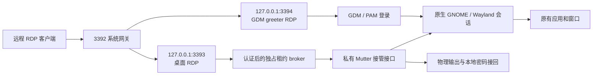

# Ubuntu Native Session Takeover

通过 RDP 接管同一个原生 GNOME/Wayland 桌面，保留当前窗口和应用进程；支持物理屏幕隐私保护、本机密码接回，以及实验性的 GDM 登录交接。

Experimental RDP takeover of the original GNOME Wayland session, with physical-seat privacy and authenticated local reclaim. This is a source release for development and review, not a supported general-purpose installer.

**项目状态：实验性源码发布。** 最近的启动锁与登录交接修复已通过隔离测试；真实冷启动 GDM/PAM、物理显示与所有客户端组合的完整验收仍未记录。本仓库不附带开发机器的安装包、凭据、日志或编译产物，也不提供“克隆后直接安装”的保证。

## 能做什么

- 远程与本地操作同一个 GNOME Shell、同一组应用；RDP 断开不会主动注销桌面。
- 认证后隔离物理输入。物理输出显示独立的密码接回界面，远程采集继续读取桌面场景。
- 本机密码经 PAM 验证成功后，先撤销远程捕获和输入，再恢复本地访问。
- 临时调整远程分辨率、缩放和显示器布局，断开后恢复保存的布局；不把临时布局写入 `monitors.xml`。
- 开机登录模式将 RDP 转发到实际 GDM greeter，随后重定向到该用户的物理桌面；不创建另一个工作桌面。
- 启动锁状态不同步时重试确认，超时后提供本地认证恢复，避免永久停留在隐私黑屏。

注销、重启或 compositor 崩溃仍会结束应用。断开 RDP 与注销是不同操作。

## 架构



3393 和 3394 是回环后端；3392 是系统登录模式的外部入口。网关转发加密 RDP，RDP 认证由 GRD/FreeRDP 执行，系统账号认证由 GDM/PAM 执行。登录交接建立新的 RDP 握手，不会把已认证的字节流直接切换到另一个后端。

详见 [架构与状态机](docs/ARCHITECTURE.md)。

## 平台范围

开发目标为 **Ubuntu 26.04 amd64、GNOME Shell/Mutter 50.1、Mutter ABI 18、GRD 50.2**，仅接受兼容配置中列出的精确软件包组合。源码补丁基线固定为：

| 组件 | 提交 |
|---|---|
| Mutter 50.1 | `8e9bb806da4a6a4fc87aa4a481b228dba6735cbd` |
| GNOME Remote Desktop 50.2 | `60423c896a54e3eacb65bd93167e91c1ce5e648c` |

Mutter 补丁包含列出的四个 Ubuntu `50.1-0ubuntu2.4` 增补补丁，不代表完整发行版 patch series。GNOME Shell、Mutter 库和系统 typelibs 必须匹配；Ubuntu 24.04 源码测试之外，目标 CI 在隔离的 Ubuntu 26.04 容器内构建并运行真实 Shell/Mutter/GRD。支持状态以对应提交的 Actions 结果为准，不由配置文件的存在决定。

启动前检查会核对 ABI、运行资源、产物清单和目标集成测试收据。未经验证的组合仅在确认没有启动隐私保护和现存 compositor 时，才回退到系统 Shell；此会话的原生接管后端保持关闭。锁保护或会话状态不明时拒绝启动，不自动解除保护。详见 [兼容配置、升级与安全回退](docs/COMPATIBILITY.md)。

## 获取与测试

```bash
git clone https://github.com/zuichu35/ubuntu-session-takeover.git
cd ubuntu-session-takeover
/usr/bin/python3 scripts/test-unit.py
```

依赖和固定上游源码获取见 [构建说明](docs/BUILDING.md)。单元测试、C 测试、隔离桌面集成和实机验收的区别见 [测试说明](docs/TESTING.md)。构建过程使用私有目录，不应替换 `/usr` 下的系统 Mutter。

2026-10-28 的开发验证覆盖独立双锁状态、超时恢复、错误密码、过期回调、原会话输入、断线重连和真实 FreeRDP 重定向。后一测试会先停止源 RDP，再延迟启动目标，并确认客户端重新握手后输入到达目标应用。测试中的 logind 会话与 PAM 使用替身；这些结果不替代真实开机登录验收。

## 部署状态

本次先发布源码与维护工具，**不发布预编译二进制或正式安装版本**。`scripts/install-*-fix.py` 等升级脚本要求已有部署、精确旧清单与备份；它们不是首次安装器。历史入口与会改变服务状态的命令列在 [部署及维护边界](docs/DEPLOYMENT.md)。

修改 Mutter 后，需要用户保存工作并正常重新登录或重启才能加载；重启 RDP 服务不会替换正在运行的 Wayland compositor。不要把当前应用能否无损迁移到新 compositor 当成项目功能。

## 代码导航

| 文件 | 职责 |
|---|---|
| `takeover/native-privacy.c` | 物理输入/输出保护、双重锁确认、本地恢复状态机 |
| `takeover/native-local-lock.c`、`local-auth.c` | 本地认证界面与无 setuid 的 PAM helper |
| `takeover/native_broker.py` | 独占租约和显示布局协调 |
| `takeover/login_gateway.py` | 端点校验、提前重定向、目标等待及本地恢复核验 |
| `takeover/startup_guard.py`、`session_health.py` | 启动等待、网关重注册与监督心跳 |
| `scripts/native-shell.py`、`native-session.py` | 加载私有 Mutter、启动当前物理会话的后端 |
| `compat/profiles/`、`takeover/compatibility.py`、`startup_policy.py` | 精确兼容配置、只读启动检查、受约束的系统 Shell 回退 |
| `patches/` | 固定版本 Mutter / GRD 补丁及发行版来源清单 |

## 安全与验证边界

- RDP 接管必须先认证；后端仅绑定回环，控制 socket 校验 Unix 对端身份与 logind 会话属性。
- 本机密码经私有管道传入 PAM helper，不通过命令行传递，也不写入日志。
- 超时不能自动解除未认证的隐私保护。正确本机认证后，远程捕获/输入必须先被撤销。
- 测试接口仅在显式开启测试模式的 headless compositor 中可用，物理会话拒绝这些接口。
- 不防御已经能执行任意同 UID 代码的程序；也不保证所有 GNOME 扩展、GPU、显示器与 RDP 客户端组合兼容。
- 请勿在 issue 中上传密码、私钥、完整用户环境或未脱敏的桌面截图。

新增实现采用 **GPL-2.0-or-later**，见 [COPYING](COPYING)。上游派生代码保留各自的许可与作者信息，见 [第三方来源](THIRD_PARTY_NOTICES.md)。
